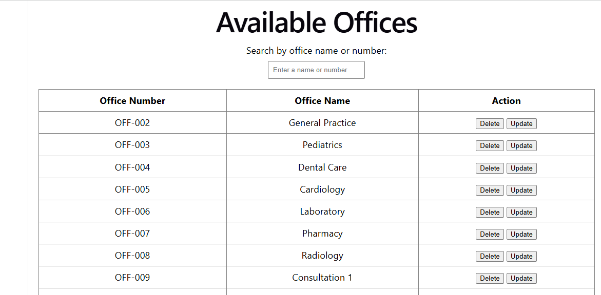

# Clinic Wednesday

## Frontend

The React frontend is in the `frontend` folder. Start it with `npm install` followed by `npm run dev` from that folder. The offices page loads office records from the backend at `http://localhost:8081/api/offices` and supports searching by office name or number and deleting records.

### Available Offices

